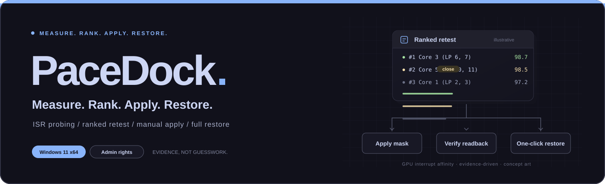

<p align="center">
  <a href="https://liutouo.github.io/PaceDock-releases/en/">
    
  </a>
</p>

<p align="center">
  
</p>

<h1 align="center">PaceDock</h1>

<p align="center">
  <strong>Measure. Rank. Apply. Restore.</strong>
</p>

<p align="center">
  A Windows GPU physical-core tuning tool.<br>
  Benchmark interrupt-affinity candidates with a synthetic load. You decide what to apply.
</p>

<p align="center">
  <a href="https://github.com/LiuTouo/PaceDock-releases/releases/latest"></a>
  <a href="https://github.com/LiuTouo/PaceDock-releases/actions/workflows/pages.yml"></a>
  <a href="#get-started"></a>
  <a href="#data-and-operation-boundaries"></a>
</p>

<p align="center">
  <a href="https://github.com/LiuTouo/PaceDock-releases/releases/latest"><strong>Download for Windows</strong></a>
  &nbsp; · &nbsp;
  <a href="https://liutouo.github.io/PaceDock-releases/en/"><strong>Product website</strong></a>
  &nbsp; · &nbsp;
  <a href="https://liutouo.github.io/PaceDock-releases/en/#demo"><strong>Interactive demo</strong></a>
  &nbsp; · &nbsp;
  <a href="README.md">繁體中文</a>
</p>

<p align="center">
  <a href="#what-can-you-do">Features</a> ·
  <a href="#get-started">Get started</a> ·
  <a href="#data-and-operation-boundaries">Boundaries</a> ·
  <a href="#for-a-closer-look-at-the-engineering">Engineering</a>
</p>

---

## Who is it for?

No overclocking, no guessing. PaceDock measures the answer to "which cores handle GPU interrupts best".

| Unstable frames                                          | Visible interrupts                                          | Reversible changes                                                  |
| :------------------------------------------------------- | :---------------------------------------------------------- | :------------------------------------------------------------------ |
| Frame rates jump around; find the smoothest physical core for GPU interrupts by testing. | See which logical processors actually service GPU interrupts—not just registry settings. | Apply with readback verification and restore the original Windows policy at any time. |

> PaceDock tunes **GPU interrupt affinity and mouse sensor rotation**. It is not an overclocking tool: frequencies, voltages, and fans are untouched.

## What can you do?

| Capability               | What it means for you                                                                                    |
| :----------------------- | :------------------------------------------------------------------------------------------------------- |
| **ISR probing**          | Sample 3 seconds and list the logical processors that actually service GPU interrupts, with core mapping and counts; shown separately from affinity settings. |
| **Automated testing**    | Auto-calibrated FPS cap; candidates run in random order with warm-up and sampling, then the top two are retested in reverse order. |
| **Readable results**     | Consistent, close, reversed, or insufficient data are labeled explicitly; a single candidate is labeled as having no comparison. |
| **Manual apply**         | You choose among valid retested candidates; the backend validates device and full LP sets, writes the mask, and reads it back. |
| **Full restore**         | A complete policy snapshot is saved before apply; restore the pre-test Windows policy at any time.       |
| **Mouse rotation & calibration** | Rotate the sensor ±30° using the bundled officially signed Raw Accel driver (MIT); slide along a guide to measure and suggest a compensation angle. |

Candidates cover every logical processor of a physical core (SMT siblings and core 0 included); the UI reads, for example, "Physical core 1 (LP 2, 3)".

## Get started

### 01 · Choose a download

Open the **[latest Release](https://github.com/LiuTouo/PaceDock-releases/releases/latest)** and select an asset:

| Windows installer                                                | Portable edition                                                  |
| :--------------------------------------------------------------- | :---------------------------------------------------------------- |
| Download `PaceDock_X.Y.Z_x64-setup.exe` and follow the installer. | Extract the entire `PaceDock_X.Y.Z_x64-portable.zip` and run it.   |
| Supports automatic updates.                                      | Checks for updates at launch and can replace its own executable.  |

**Requirements: Windows 11 x64, Microsoft WebView2 Runtime, and administrator rights** (GPU policy operations). Every release asset ships with a SHA256 checksum file. Windows binaries are unsigned; a SmartScreen warning is expected behavior.

### 02 · Run a test

Pick your GPU, review the candidate list, and start. Progress and estimates are shown per stage with cancellation available; the pre-test policy is restored before the final retest ranking.

### 03 · Apply and restore

Choose a valid retested candidate and confirm (the display may blink briefly). Review history anytime, or restore the original Windows policy with one click.

> **Try it before downloading.** [Explore the interactive walkthrough](https://liutouo.github.io/PaceDock-releases/en/#demo). The website uses fictional data only and never touches your system settings.

## Data and operation boundaries

- **A quick test is not proof for real games.** Rankings reflect this synthetic load only; the "close" label is a display heuristic, not an FPS gain or statistical significance.
- **GPU operations need administrator rights.** Apply and restore restart the display device, which may blink briefly; other GPU operations are locked out during tests, applies, and restores.
- **No anti-cheat compatibility guarantee for the mouse driver.** The bundled Raw Accel driver is the officially signed build (MIT) with community history including FaceIT and VAC; individual anti-cheat policies may change—evaluate the risk yourself.
- **HVCI (memory integrity) compatibility is pending real-machine verification**; driver install and removal require a reboot to take effect.
- **Mouse angle writes replace the official settings file wholesale.** Running alongside the Raw Accel GUI may overwrite each other's settings.
- **Calibration accuracy is a design goal.** "Retest difference below 0.5° with sufficient travel" is not yet verified on real hardware; insufficient or off-guide movement asks for a redo.

## For a closer look at the engineering

```text
Svelte 5 / TypeScript  →  Tauri 2 IPC  →  Rust  →  PresentMon + Windows API
```

| Engineering area       | Design focus                                                                                          |
| :--------------------- | :---------------------------------------------------------------------------------------------------- |
| **Test engine**        | Topology-aware candidate generation (full LP sets per physical core), two-stage sampling, reverse-order retest. |
| **Operation safeguards** | Device and core fingerprint validation, a single exclusive operation lock, post-write readback, cancellation and crash recovery. |
| **Verification & delivery** | Rust and frontend tests in the desktop project; release assets ship with SHA256 checksums and update manifests. |

Passing tests does not mean every GPU, driver, or game has been performance-verified. The **website checks** badge above represents checks for this public website only.

## About this repository

This public repository provides **Windows releases, product information, and the website**. The desktop application's source code is not public. A public download does not imply an open-source or commercial-use license; this page does not add license terms, enterprise compliance claims, or an SLA.

GPU benchmarking bundles third-party components (each MIT-licensed, full texts included): PresentMon 2.5.1 (Intel) and the liblava Vulkan workload; mouse rotation uses the Raw Accel v1.7.1 officially signed kernel driver (MIT).

---

<p align="center">
  <strong>Measure. Rank. Apply. Restore.</strong><br><br>
  <a href="https://github.com/LiuTouo/PaceDock-releases/releases">All releases</a> ·
  <a href="https://github.com/LiuTouo">Author on GitHub</a> ·
  <a href="CONTRIBUTING.md">Website maintenance</a>
</p>
