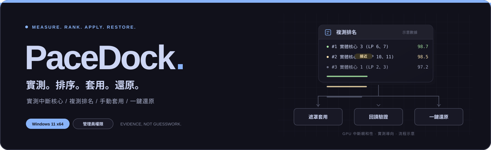

<p align="center">
  <a href="https://liutouo.github.io/PaceDock-releases/">
    
  </a>
</p>

<p align="center">
  
</p>

<h1 align="center">PaceDock</h1>

<p align="center">
  <strong>實測。排序。套用。還原。</strong>
</p>

<p align="center">
  Windows GPU 實體核心調校工具。<br>
  以合成負載比較 GPU 中斷親和性的候選，排名後由你決定套用。
</p>

<p align="center">
  <a href="https://github.com/LiuTouo/PaceDock-releases/releases/latest"></a>
  <a href="https://github.com/LiuTouo/PaceDock-releases/actions/workflows/pages.yml"></a>
  <a href="#快速開始"></a>
  <a href="#資料與操作邊界"></a>
</p>

<p align="center">
  <a href="https://github.com/LiuTouo/PaceDock-releases/releases/latest"><strong>下載 Windows 版</strong></a>
  &nbsp; · &nbsp;
  <a href="https://liutouo.github.io/PaceDock-releases/"><strong>產品網站</strong></a>
  &nbsp; · &nbsp;
  <a href="https://liutouo.github.io/PaceDock-releases/#demo"><strong>互動示範</strong></a>
  &nbsp; · &nbsp;
  <a href="README.en.md">English</a>
</p>

<p align="center">
  <a href="#你可以做什麼">核心功能</a> ·
  <a href="#快速開始">快速開始</a> ·
  <a href="#資料與操作邊界">能力邊界</a> ·
  <a href="#給想了解工程設計的人">工程設計</a>
</p>

---

## 適合什麼情境？

不需要超頻，也不需要猜。PaceDock 用量測回答「GPU 中斷放在哪些核心最順」。

| 幀不穩，想找對核心                                       | 看得見的中斷                                       | 改動可逆                                             |
| :------------------------------------------------------- | :------------------------------------------------- | :--------------------------------------------------- |
| 遊戲幀率忽高忽低，想用實測找出 GPU 中斷最順的實體核心。 | 想知道中斷實際落在哪些邏輯處理器，而不是只看設定。 | 要的是套用後回讀驗證，以及隨時回到原始策略的還原。   |

> PaceDock 調校的是 **GPU 中斷親和性與滑鼠感測器角度**，不是超頻工具：不修改頻率、電壓或風扇。

## 你可以做什麼？

| 能力               | 使用方式                                                                                             |
| :----------------- | :--------------------------------------------------------------------------------------------------- |
| **實測中斷核心**   | 取樣 3 秒，列出實際處理 GPU 中斷的邏輯處理器、對應實體核心與次數；與親和性設定分開顯示。             |
| **自動測試**       | 自動校準 FPS cap，候選隨機排列、依序暖機與取樣；前兩名再以相反順序複測一次。                         |
| **結果判讀**       | 排名一致、差異接近、排名反轉或資料不足明確標示；單一候選標示「無比較對象」。                         |
| **手動套用**       | 有效複測候選由你選擇；後端驗證裝置與完整邏輯處理器集合後寫入遮罩，並回讀確認。                       |
| **完整還原**       | 套用前保存完整策略快照；隨時可還原成測試前的 Windows 原始策略。                                     |
| **滑鼠旋轉與校準** | 內建 Raw Accel 官方簽署驅動（MIT）套用 ±30° 感測器旋轉；沿引導線滑動即可量測並建議補償角。          |

候選涵蓋整顆實體核心的全部邏輯處理器（含 SMT sibling 與核心 0），介面統一顯示例如「實體核心 1（LP 2、3）」。

## 快速開始

### 01 · 選擇下載方式

前往 **[最新 Release](https://github.com/LiuTouo/PaceDock-releases/releases/latest)**，在 Assets 選擇適合你的檔案：

| Windows 安裝版                                       | Portable 免安裝版                                                 |
| :--------------------------------------------------- | :---------------------------------------------------------------- |
| 下載 `PaceDock_X.Y.Z_x64-setup.exe`，依指示安裝。    | 下載 `PaceDock_X.Y.Z_x64-portable.zip`，完整解壓後即可執行。      |
| 支援自動更新。                                       | 啟動時自動檢查更新，可下載新版並替換執行檔。                       |

**系統需求：Windows 11 x64、Microsoft WebView2 Runtime 與管理員權限**（GPU 策略操作需要）。每個發布資產均附 SHA256 校驗檔。Windows 二進位檔未經數位簽章，SmartScreen 可能顯示警告，屬預期行為。

### 02 · 執行測試

選擇 GPU，檢視候選清單，開始測試。過程顯示階段與預估時間，可隨時取消；結束後自動還原測試前的策略，再進入複測排名。

### 03 · 套用與還原

從有效複測候選中選擇，確認後套用（畫面可能短暫閃黑）。之後隨時可以在歷史紀錄中回顧，或一鍵還原成 Windows 原始策略。

> **先體驗，再下載。** [試一次測試與套用流程](https://liutouo.github.io/PaceDock-releases/#demo)。網頁只使用虛構數據，不會讀寫你的系統設定。

## 資料與操作邊界

- **快速測試不等於實機遊戲證明。** 排名只反映本次合成負載的表現；「差異接近」是顯示用啟發式，不是 FPS 改善幅度或統計顯著性。
- **GPU 操作需要管理員權限。** 套用與還原會重啟顯示裝置，畫面可能短暫閃黑；測試、套用與還原期間不可同時執行其他 GPU 操作。
- **滑鼠驅動的 anti-cheat 相容無保證。** 內建 Raw Accel 官方已簽署驅動（MIT），社群實績包括 FaceIT 與 VAC；但個別 anti-cheat 政策可能改變，請自行評估風險。
- **HVCI（記憶體完整性）相容性尚待實機驗證**；驅動安裝與解除需要重新開機才生效。
- **滑鼠角度寫入採官方設定檔整檔替換。** 與 Raw Accel GUI 並用時，雙方的設定可能互相覆蓋。
- **校準精度為設計目標。** 「足夠位移下重測差異小於 0.5°」尚待實機驗證；位移不足或偏離引導線會要求重測。

## 給想了解工程設計的人

```text
Svelte 5 / TypeScript  →  Tauri 2 IPC  →  Rust  →  PresentMon + Windows API
```

| 工程面向       | 設計重點                                                                                       |
| :------------- | :--------------------------------------------------------------------------------------------- |
| **測試引擎**   | 依 CPU 拓撲產生候選（整顆實體核心的完整 LP 集合）、兩階段暖機取樣與相反順序複測。              |
| **操作保護**   | 裝置與核心指紋驗證、單一排他操作鎖、遮罩寫入後回讀、取消保護與 crash recovery。                |
| **驗證與交付** | 桌面專案有 Rust 與前端測試；發行檔附 SHA256 校驗與自動更新清單。                               |

測試通過不代表已在每款 GPU、驅動或遊戲上驗證效能；上方 **website checks** 徽章只代表此公開網站的檢查狀態。

## 關於這個 repository

此公開庫提供 **Windows 發行檔、產品介紹與網站**；PaceDock 桌面應用原始碼未公開。公開可下載不等於開源或已授予商用授權；本頁不新增授權條款、企業合規或 SLA 承諾。

GPU 基準測試內建第三方元件（各自採 MIT 授權並隨附全文）：PresentMon 2.5.1（Intel）、liblava Vulkan workload；滑鼠旋轉使用 Raw Accel v1.7.1 官方簽署核心驅動（MIT）。

---

<p align="center">
  <strong>實測。排序。套用。還原。</strong><br><br>
  <a href="https://github.com/LiuTouo/PaceDock-releases/releases">所有版本</a> ·
  <a href="https://github.com/LiuTouo">作者 GitHub</a> ·
  <a href="CONTRIBUTING.md">網站維護說明</a>
</p>
